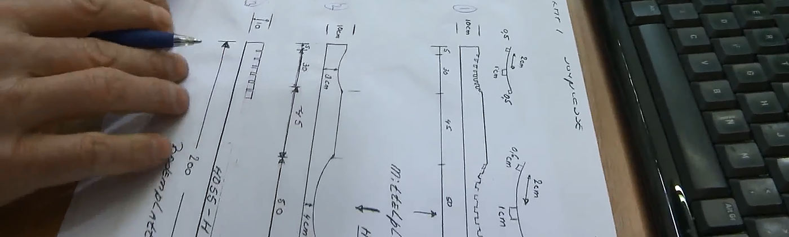

### Mijn passie voor slapen: Chris Nederhorst, de Matrassenexpert achter Royal Health Foam & Matras.info

Welkom op mijn persoonlijke website. Ik ben Chris Nederhorst en mijn hele werkzame leven ({{jarenBeddenvak}} jaar) staat in het teken van één doel: het ontwerpen en produceren van de best mogelijke koudschuim- en traagschuim matrassen die perfecte ondersteuning en comfort bieden. Voor mij is een matras niet zomaar een gebruiksvoorwerp; het is de belangrijkste basis voor een gezonde nachtrust en een pijnvrij leven.

### Hoe het allemaal begon (1988 - 1990)

Mijn fascinatie voor het vak ontstond in 1988 toen ik in een beddenwinkel ging werken. Vrijwel direct werd ik gegrepen door de techniek achter comfort. Terwijl anderen een matras zagen als een rechthoekig blok schuim, zag ik de techniek, de anatomie en de enorme impact die materiaalgebruik heeft op het menselijk lichaam. Ik werd al snel een 'slaap-fanaat' die alles wilde weten over hoe ons lichaam zich herstelt tijdens de nacht.

In 1990 zette ik de stap naar het ondernemerschap. Samen met mijn vrouw en zwager startte ik H2O Waterbedden in de Javastraat in Den Haag. We merkten al snel dat mensen snakten naar écht goed advies en de mogelijkheid om producten uit te proberen. Daarom waren wij een van de eersten die matrassen op proef gaven. Dat bleek een schot in de roos; klanten kwamen uit het hele land naar ons toe voor die unieke zekerheid.

### De revolutie in traagschuim (1997 - 1998)

In die tijd kwam traagschuim op de markt. Het was revolutionair qua drukverlaging en mensen vonden het heerlijk slapen, maar ik hoorde van mijn klanten één klacht die steeds weer terugkwam: "Pffh, het is zo ontzettend warm." De toenmalige matrassen werden verlijmd met synthetische lijmstoffen die de ventilatie volledig blokkeerden.

Ik wist dat dit beter kon, zeker voor mensen met medische klachten zoals reuma, Parkinson of chronische rugpijn. Voor hen is drukverlaging essentieel, maar een broeierig matras is funest (zeker voor Reumapatiënten). In 1997 ben ik daarom zelf gaan experimenteren. Door te werken met lijmen op waterbasis in combinatie met open celstructuren koudschuim, slaagden we erin het eerste écht ventilerende traagschuim matras te ontwikkelen. En dit was of eigenlijk is de 23 de Luxe (tegenwoordig de Original Support). In 1998 richtte ik hiervoor Royal Health Foam op onder de naam Winwinwin B.V. – omdat ik geloof dat een bedrijf alleen bestaansrecht heeft als de klant, de leverancier én de ondernemer, en dus iedereen er beter van worden.

### Medische expertise en erkenning

Mijn streven naar kwaliteit bleef niet onopgemerkt. Ik ben er bijzonder trots op dat onze expertise inmiddels breed wordt erkend in de medische wereld. Onze matrassen liggen (of lagen) in gerenommeerde instellingen zoals het AMC Amsterdam, het BovenIJ Ziekenhuis en Bronovo in Den Haag. Het gegeven dat ziekenhuizen zoals het Erasmus MC en het AMC voor onze expertise kiezen, is voor mij het ultieme bewijs dat we doen wat we beloven: de best mogelijke ondersteuning bieden in de meest veeleisende omgevingen.

Een absoluut hoogtepunt in mijn carrière tot nu toe is de samenwerking met het Erasmus MC in Rotterdam. Sinds eind 2019 werken wij intensief met hen samen aan een bijzonder project waarbij onze expertise op het gebied van drukverlaging en decubituspreventie direct bijdraagt aan het welzijn van patiënten. En nu, 2026 werk ik nog steeds samen met het Erasmus ziekenhuis. Als onze matrassen zich kunnen bewijzen in de meest veeleisende ziekenhuisomgevingen, dan weet ik zeker dat ze ook bij u thuis het verschil kunnen maken.

### Technische perfectie: De 'Rolls Royce' onder de materialen

Bij de ontwikkeling van mijn matrassen, zoals de bekende Original Support (voorheen de RHF 23 de Luxe), neem ik nooit genoegen met 'het is goed genoeg'. Die zucht naar verbetering zie je terug in onze materiaalkeuze. We werken met Eupen Schuim – de absolute top uit België en Duitsland – want dit schuim staat in de industrie bekend als de 'Rolls Royce' onder de schuimers vanwege de ongeëvenaarde consistentie en duurzaamheid.

Onze technische innovaties gaan echter verder dan alleen het schuim:

- Watergebaseerde verlijming: Wij gebruiken uitsluitend lijmen op waterbasis. Hierdoor blijven de open cellen van het schuim ook na verlijming open, wat essentieel is voor de luchtcirculatie en vochtafvoer. Daarnaast is waterbasis lijm vrij van Formaldehyde.
- Tencel® technologie: Onze matrashoezen (tijken) zijn gemaakt van Tencel, een natuurlijke vezel uit eucalyptushout. Dit materiaal neemt tot drie keer meer vocht op dan katoen en is van nature antibacterieel.
- Vrij van schadelijke stoffen: Sinds 2005 zijn al onze matrassen volledig vrij van giftige brandvertragers en andere (meestal schadelijke) chemicaliën. Ik geloof dat een gezond lichaam niet acht uur per dag in contact moet komen met ongezonde dampen. Een matras moet niet alleen lekker liggen, het moet ook volledig veilig en gezond zijn.

### Transparante kennis en innovatie in de matrassenwereld

In 2001 merkte ik dat er online veel onjuiste informatie werd verspreid door de matrassenbranche. Door mijn expertise te delen op platforms als [www.matras.info](https://www.matras.info) en [www.koudschuim.info](https://www.koudschuim.info) . wil ik consumenten voorzien van feiten in plaats van verkooppraatjes. Deze transparantie vormt ook de basis van mijn bedrijf Royal Health Foam ([www.healthfoam.com](https://www.healthfoam.com) ) waar ik ook volledig kies voor transparantie en openheid van zaken. Of het nu gaat om online voorlichting of een persoonlijk gesprek: mijn doel is om op basis van uw specifieke klachten en lichaamstype het matras te vinden dat uw slaap en levenskwaliteit echt verbetert.

### Persoonlijk advies en het familiebedrijf

Ondanks de groei en de successen in de medische wereld, is Royal Health Foam in 2026 nog steeds een hecht familiebedrijf. Ik werk elke dag samen met mijn vrouw, mijn dochter en mijn zwager en natuurlijk met het loyale team van specialisten zoals Jonathan en Behar, die inmiddels al bijna twintig jaar bij ons zijn.

### U bent van harte welkom in Scheveningen

Ik nodig u van harte uit in onze showroom in Scheveningen. Hier kunt u zelf het verschil voelen tussen de verschillende densiteiten schuim en de ventilatie van onze tijken ervaren. De koffie staat klaar en ik — of een van mijn deskundige collega's — help u graag met een eerlijk, transparant en vakkundig advies

Samen zorgen we ervoor dat u weer geniet van uw nachtrust.
